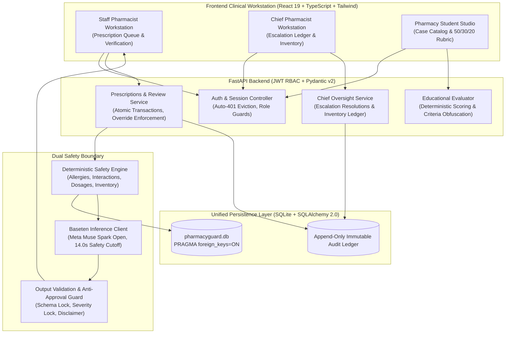

# PharmacyGuard — Clinical Pharmacy Decision Support & Simulation

> **Meta Global AI Developer Hackathon Submission**  
> *Track: Build for Your World / Healthcare & Clinical Systems*  
> *Powered by Meta Muse Spark Open (`meta-models/muse-spark-open-1026`) via Baseten Hosted Inference*  
> 
> **Non-Clinical Demonstration Prototype**: PharmacyGuard is an educational and operational pharmacy decision-support prototype. All patient data, clinical cases, and inventory figures are synthetic. This system has **not** been clinically validated and must **never** be used for real-world patient care or medication dispensing.

---

## Executive Summary

Hospital pharmacies process hundreds of complex prescriptions daily under severe time constraints. Standard pharmacy information systems produce alert fatigue through blunt, binary pop-ups, while naive generative AI systems introduce dangerous hallucinations and liability risks.

**PharmacyGuard** solves this with a **Dual Safety Boundary** architecture:
1. **Authoritative Deterministic Engine:** Hard clinical safety rules (IgE allergy cross-reactivity, pharmacokinetic drug interactions, daily dosage limits, therapeutic duplication, and real-time inventory shortage) are evaluated strictly deterministically with zero LLM dependence.
2. **Non-Authoritative AI Clinical Synthesis:** Meta's **Muse Spark Open** frontier model (hosted via Baseten inference) interprets structured clinical alert codes into natural-language clinical context, mechanistic rationales, clinical uncertainties, and review considerations for the human pharmacist.
3. **Licensed Pharmacist Primacy:** AI is strictly prohibited from approving prescriptions, authorizing dispensing, or altering finding severities. Pharmacist override of high-severity alerts requires mandatory written rationale, committed to an append-only immutable audit ledger.

---

## System Architecture



---

## Role-Based Workspaces & Demo Credentials

PharmacyGuard supports 3 distinct clinical personas authenticated via JWT:

| Role | Username | Demo Password | Scope & Operational Authority |
| :--- | :--- | :--- | :--- |
| **Staff Pharmacist** | `pharmacist_demo` | `StaffDemoPassword2026!` | Verification queue, deterministic checks, Meta Muse Spark Open clinical explanations, review determinations (`Accept`, `Override` with mandatory rationale, `Escalate`). |
| **Chief Pharmacist** | `chief_demo` | `ChiefDemoPassword2026!` | Escalated case resolution, audit ledger review, simulated inventory adjustments, restock tracking. |
| **Pharmacy Student** | `student_demo` | `StudentDemoPassword2026!` | Case catalog, clinical assessment studio, automated 50/30/20 rubric evaluation, submission history. Read-only clinical actions. |

---

## Meta Muse Spark Open AI Integration

PharmacyGuard integrates Meta's open-weights frontier model **Muse Spark Open** (`meta-models/muse-spark-open-1026`) via Baseten's OpenAI-compatible inference API (`https://inference.baseten.co/v1`).

### AI Guardrails & Safety Constraints:
- **Primacy of Deterministic Verification:** Deterministic rules run first. AI receives structured findings and provides clinical context; it cannot invent findings or alter rule severities.
- **Anti-Approval Enforcement:** Model outputs are strictly screened. Phrases asserting autonomous approval or dispensing safety trigger immediate rejection (`ai_status="rejected"`).
- **Strict 14.0s Timeout:** Inference requests are bounded by a 14.0-second safety cutoff with graceful fallback to deterministic findings.
- **Non-Authoritative Disclaimer:** All AI outputs display a persistent non-authoritative clinical decision support notice.

---

## Synthetic Benchmark Scenarios

The database includes 5 realistic clinical scenarios demonstrating rule coverage:
1. **Scenario 1 — Routine Maintenance (`RX-2026-0001`)**: Lisinopril 10mg for Essential Hypertension (`I10`). Evaluates all rules clean.
2. **Scenario 2 — Indication Review Required (`RX-2026-0002`)**: Metformin 500mg BID without documented Type 2 Diabetes diagnosis (`E11.x`). Triggers indication review.
3. **Scenario 3 — Severe Allergy Conflict (`RX-2026-0003`)**: Amoxicillin 500mg TID prescribed to patient with documented severe Penicillin anaphylaxis (bronchospasm). Triggers HIGH severity allergy conflict and AI clinical explanation.
4. **Scenario 4 — Duplicate Systemic NSAIDs (`RX-2026-0004`)**: Concurrent Ketorolac 10mg and Ibuprofen 600mg. Triggers high-severity therapeutic duplication conflict.
5. **Scenario 5 — Simulated Stock Shortage (`RX-2026-0005`)**: Cefdinir 300mg BID (quantity 20) with only 12 units on hand. Triggers inventory deficit alert.

---

## Automated Test Verification

PharmacyGuard includes comprehensive unit, integration, and regression test suites with 100% pass rate:

- **Backend Pytest Suite:** **113 passed, 0 failed** (FastAPI, SQLAlchemy, verification engine, Baseten client, RBAC, audit immutability).
- **Frontend Vitest Suite:** **114 passed, 0 failed** across 9 test files (React 19, workspace shells, queue filters, review modals, AI explanation states).
- **Total Tests:** **227 passing tests**.
- **Production Build:** `npm run build` cleanly compiled (`tsc -b && vite build`, 0 errors).

---

## Quickstart

### Prerequisites
- Python 3.11+
- Node.js 20+

### 1. Backend Setup
```bash
cd backend
python -m venv .venv

# On Windows:
.venv\Scripts\activate
# On Linux/macOS:
source .venv/bin/activate

pip install -r requirements.txt

# Run full backend test suite (113 tests)
python -m pytest

# Start backend server
python -m uvicorn app.main:app --host 127.0.0.1 --port 8000
```

### 2. Frontend Setup
```bash
cd frontend
npm install

# Run frontend tests (114 tests)
npm test

# Build production bundle
npm run build

# Start Vite dev server
npm run dev
```

Visit `http://localhost:5173` to explore the clinical workstations.
