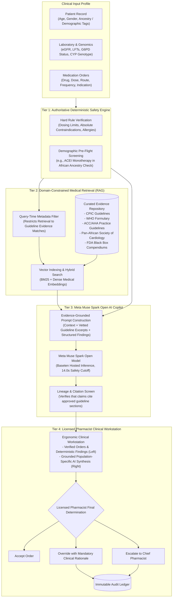

# PharmacyGuard Clinical Specification: Domain-Constrained Medical Retrieval & Population-Specific Pharmacotherapy Guidance

> **Document ID:** SPEC-CLIN-2026-01  
> **Status:** Proposed Specification for Future Clinical Deployment  
> **Author:** PharmacyGuard Clinical Architecture Working Group  
> **Target Audience:** Clinical Pharmacists, Healthcare Informaticians, AI Safety Engineers  

---

## 1. Executive Summary & Clinical Rationale

As healthcare decision-support systems transition from academic prototypes to real-world clinical environments, artificial intelligence models face a critical safety hazard: **algorithmic demographic bias and ungrounded pharmacological extrapolation**.

Standard frontier large language models (LLMs) are predominantly trained on vast, uncurated web corpora that over-represent clinical literature and clinical trial populations from high-income Caucasian cohorts. When naive LLMs generate clinical recommendations without strict guidance, they risk applying clinical guidelines calibrated for Caucasian demographics to patients of African, Mediterranean, or other ancestral backgrounds—or vice versa.

In real-world pharmacotherapy, **population-specific pharmacogenomics, renin-angiotensin physiology, and enzymopathy distributions fundamentally dictate drug efficacy, dosage requirements, and adverse event profiles**. Treating all patients according to an unstratified, generic pharmacological baseline increases clinical oversights, therapeutic failures, and adverse drug reactions (ADRs).

**PharmacyGuard's future clinical architecture** mandates that the AI decision-support engine be permanently grounded in **curated, authoritative medical compendiums** using **Domain-Constrained Retrieval-Augmented Generation (Medical RAG)**. The model will be strictly prohibited from generating open-ended pharmacotherapy advice from unverified training weights.

---

## 2. Key Clinical Case Studies in Population Pharmacotherapy

To illustrate the imperative for domain-constrained medical retrieval, four prominent clinical scenarios demonstrate where demographic and population-specific guidelines diverge significantly:

### 2.1 First-Line Antihypertensive Monotherapy in Patients of African Descent

* **Physiological Basis:** Essential hypertension in patients of African descent is characterized by a high prevalence of **low-renin hypertension**, increased vascular sensitivity, and enhanced renal sodium retention.
* **Guideline Standard (ACC/AHA 2017, JNC-8, British Hypertension Society, Pan-African Society of Cardiology):**
  * In Black/African adult patients with hypertension without chronic kidney disease (CKD), initial first-line monotherapy **must be a Calcium Channel Blocker (CCB, e.g., Amlodipine) or a Thiazide/Thiazide-like Diuretic (e.g., Chlorthalidone, Indapamide)**.
  * Monotherapy with **Angiotensin-Converting Enzyme (ACE) Inhibitors** (e.g., Lisinopril, Enalapril) or **Angiotensin Receptor Blockers (ARBs)** yields significantly less blood pressure reduction and stroke prevention in this population compared to CCBs or diuretics.
* **Acute Safety Hazard — Angioedema:**
  * Patients of African descent have a **3- to 4-fold higher incidence of life-threatening ACE-inhibitor-induced angioedema** (swelling of the airway, tongue, and larynx) compared to Caucasian patients.
* **Failure Mode of Ungrounded AI:**
  * An unconstrained AI model might evaluate a prescription for Lisinopril 10 mg monotherapy for a Black patient and declare it "standard first-line therapy for essential hypertension," missing both the reduced monotherapy efficacy and the elevated angioedema risk.
* **Guarded AI Behavior:**
  * When grounded in ACC/AHA Section 10.1 and Pan-African Society of Cardiology guidelines, the AI flags:
    > *"In adult patients of African ancestry without proteinuria/CKD, guidelines recommend initial therapy with a CCB or thiazide diuretic. Lisinopril monotherapy demonstrates reduced efficacy and carries a 3-4x elevated risk of angioedema. Consider combination therapy or substitution."*

---

### 2.2 Glucose-6-Phosphate Dehydrogenase (G6PD) Deficiency & Hemolytic Crises

* **Genetic Distribution:** G6PD deficiency is an X-linked enzymopathy affecting over 500 million people worldwide, with the highest prevalence in populations of sub-Saharan African (up to 15–20% in specific regions), Mediterranean, Middle Eastern, and Southeast Asian descent.
* **Clinical Hazard:** In G6PD-deficient red blood cells, exposure to oxidant medications depletes reduced glutathione, leading to acute intravascular hemolysis, hemoglobinuria, and severe acute renal failure.
* **High-Risk & Contraindicated Medications:**
  * **Absolute Contraindication:** **Rasburicase** (FDA Black Box Warning: severe hemolytic anemia and methemoglobinemia).
  * **High Risk:** **Primaquine**, **Dapsone**, **Methylene Blue**, **Nitrofurantoin**, **Sulfamethoxazole**.
* **Guarded AI Behavior:**
  * If a high-risk oxidant drug is prescribed, the system queries the patient's G6PD screening status. If unverified in a high-prevalence demographic, the AI highlights:
    > *"Rasburicase is strictly contraindicated in G6PD deficiency. Ensure G6PD enzymatic assay is documented prior to administration to avoid fatal acute hemolysis."*

---

### 2.3 Pharmacogenomic Polymorphisms in Antiplatelet Therapy (CYP2C19 & Clopidogrel)

* **Mechanism:** Clopidogrel (Plavix) is an inactive prodrug requiring two-step hepatic bioactivation by CYP2C19.
* **Population Frequency:** The loss-of-function alleles (`CYP2C19*2` and `CYP2C19*3`) have varying frequencies across ancestries (up to 30% in East Asian populations and ~15% in African and Caucasian populations).
* **Clinical Hazard:** Intermediate or poor metabolizers cannot produce sufficient active drug, leading to antiplatelet failure and stent thrombosis following percutaneous coronary intervention (PCI).
* **Guarded AI Behavior:**
  * Grounded in CPIC (Clinical Pharmacogenetics Implementation Consortium) guidelines, the AI flags:
    > *"CPIC Guideline recommends alternative P2Y12 inhibitors (e.g., Ticagrelor or Prasugrel) in confirmed or suspected CYP2C19 intermediate/poor metabolizers to prevent ischemic recurrence."*

---

### 2.4 Sickle Cell Disease / Trait Pharmacotherapy & Nephrotoxic Safeguards

* **Clinical Context:** Sickle cell hemoglobinopathy is prevalent in individuals of sub-Saharan African, Mediterranean, and Indian ancestry.
* **Clinical Hazard:** Patients with sickle cell disease commonly experience vaso-occlusive crises (VOC). Repetitive, high-dose systemic nonsteroidal anti-inflammatory drugs (NSAIDs, e.g., Ketorolac, Ibuprofen) can cause rapid deterioration of renal function in patients with subclinical sickle cell nephropathy.
* **Guarded AI Behavior:**
  * Grounded in ASH (American Society of Hematology) Sickle Cell Pain Guidelines, the AI provides guidance on multimodal analgesia and flags prolonged continuous NSAID courses that threaten renal clearance.

---

## 3. System Architecture for Domain-Constrained Medical RAG

To implement these safeguards without compromising deterministic safety or clinician oversight, PharmacyGuard specifies the following multi-tier architecture:

---

## 4. Architectural Rules & Guardrails for Medical Retrieval

### Rule 1: Zero Open-Web or Uncurated Retrieval
* The retrieval engine is strictly confined to an ingested, cryptographic hash-verified repository of approved clinical guidelines.
* Uncontrolled web scraping, consumer search engines, and open forum text are strictly blocked from the AI retrieval index.

### Rule 2: Mandatory Clinical Citation & Lineage Verification
* Every therapeutic insight or demographic consideration generated by the AI must cite:
  1. The Authoritative Guideline Organization (e.g., `ACC/AHA`, `CPIC`, `WHO`).
  2. The Specific Section or Recommendation Identifier (e.g., `Section 10.1.2, Class I, Level A`).
  3. The Publication Year and Guideline Title.
* An automated **Lineage Verifier** checks model outputs. If a therapeutic claim cannot be matched to the retrieved guideline text, the claim is rejected and redacted before the pharmacist sees it.

### Rule 3: Deterministic Primacy Preserved
* Even when population guidelines suggest alternative regimens, the AI **cannot alter the deterministic safety status** or auto-substitute medications.
* Only the licensed pharmacist can contact the prescriber or authorize order adjustments.

---

## 5. Phased Implementation Roadmap

| Phase | Milestone | Scope & Deliverables | Verification Strategy |
| :--- | :--- | :--- | :--- |
| **Phase 1** | **Deterministic Demographic Rule Screening** | Implement deterministic rule flags for high-risk demographic combinations (e.g., `RULE-DEMO-HTN-AFR` for ACEI monotherapy in Black patients; `RULE-G6PD-OXIDANT` for oxidant drugs without G6PD assay). | 100% Pytest coverage of demographic edge cases. |
| **Phase 2** | **Curated Knowledge Repository Ingestion** | Ingest CPIC, ACC/AHA, WHO, and Pan-African cardiology compendiums into a HIPAA/HITECH-compliant vector database with dense medical embeddings (PubMedBERT/Med-CPT). | Benchmark retrieval recall against gold-standard clinical scenarios. |
| **Phase 3** | **Prompt Grounding & Lineage Verifier** | Connect Meta Muse Spark Open prompt generator to retrieved guideline context with regex-based citation enforcement. | Vitest + Pytest integration tests verifying rejection of ungrounded advice. |
| **Phase 4** | **Clinical Advisory Board Evaluation** | Multi-hospital double-blind evaluation by certified clinical pharmacists and pharmacogeneticists. | Review precision, clinical accuracy, and reduction of alert fatigue. |

---

## 6. Regulatory & Compliance Notice

This specification is designed to comply with:
- **FDA Guidance on Clinical Decision Support Software (September 2022)**: Ensuring software is non-device CDS where clinicians can independently review the basis of the recommendations.
- **EU Artificial Intelligence Act (High-Risk AI System Requirements)**: Mandating human oversight, transparency, data governance, and mitigation of algorithmic bias in medical applications.
- **CPIC Standard Operating Procedures**: Adhering to clinical pharmacogenetics guideline dissemination standards.
